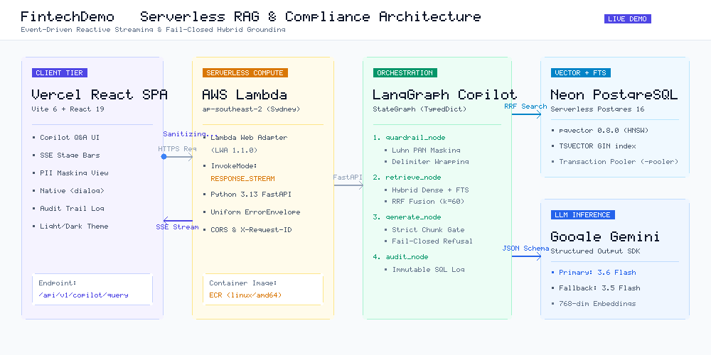

# FinTech — Financial Compliance & Policy Copilot

A production-oriented, full-stack AI compliance copilot built with **Python (FastAPI)**, **LangGraph**, **PostgreSQL + `pgvector`**, **Google Gemini**, and **React + Vite**.

Designed as an end-to-end reference architecture for regulated financial technology environments—featuring **hybrid vector + full-text retrieval**, **Luhn-validated PCI/PII masking**, **prompt-injection guardrails**, **fail-closed citation grounding**, **SSE stage streaming**, **primary-to-fallback model failover**, **immutable audit logging**, and an **LLM-as-a-Judge evaluation harness**.

🔗 **Live:** [fintech-advisor-jmco.vercel.app](https://fintech-advisor-jmco.vercel.app/)

---

## Table of Contents

1. [Architecture Overview](#architecture-overview)
2. [Why Hybrid RAG?](#why-hybrid-rag)
3. [Tech Stack](#tech-stack)
4. [Project Structure](#project-structure)
5. [Environment Configuration](#environment-configuration)
6. [Quick Start (Docker Compose)](#quick-start-docker-compose)
7. [Local Development (Hot Reload)](#local-development-hot-reload)
8. [Cloud Deployment (AWS Lambda, Neon & Vercel)](#cloud-deployment-aws-lambda-neon--vercel)
9. [Bundled SOP Corpus](#bundled-sop-corpus)
10. [API Reference & Error Envelopes](#api-reference--error-envelopes)
11. [Security, Guardrails & Auditability](#security-guardrails--auditability)
12. [Frontend Capabilities](#frontend-capabilities)
13. [CI/CD & Evals Pipeline](#cicd--evals-pipeline)
14. [License & Commercial Inquiries](#license--commercial-inquiries)

---

## Architecture Overview



FintechDemo is designed to operate seamlessly both in local containerized development and in a resilient, serverless cloud environment:

```text
┌────────────────────────────────────────────────────────────────────────────────────────┐
│  Client Tier: React 19 + Vite SPA (Vercel Edge / Local Nginx)                          │
│  • Copilot Workspace (live SSE stage progress: guardrail -> retrieve -> generate)      │
│  • PII sanitization indicators • Native <dialog> SOP Citation Inspector                │
│  • Responsive @container Audit Trail • Dark/Light CSS light-dark() theming             │
└───────────────────────────────────────────┬────────────────────────────────────────────┘
                                            │ HTTPS / SSE Streaming (/api/v1/*)
                                            ▼
┌────────────────────────────────────────────────────────────────────────────────────────┐
│  Compute Tier: FastAPI (Python 3.13) on AWS Lambda + Lambda Web Adapter (or Docker)    │
│  • InvokeMode: RESPONSE_STREAM via Lambda Function URL (no API Gateway timeout limits) │
│  • Dynamic Request-ID tracking & uniform ErrorEnvelope for all 4xx/5xx responses       │
│  • Primary-to-fallback model failover on 10s timeouts or 5xx upstream spikes           │
└───────────────────────────────────────────┬────────────────────────────────────────────┘
                                            │
                                            ▼
┌────────────────────────────────────────────────────────────────────────────────────────┐
│  Orchestration: LangGraph Stateful Compliance Copilot (StateGraph with TypedDict State)│
│                                                                                        │
│  [1. guardrail_node] ──(prompt injection or malformed)──► [4. audit_node]              │
│          │                                                        ▲                    │
│      (clean input: Luhn PAN masked, CVV/SSN/email redacted)       │                    │
│          ▼                                                        │                    │
│  [2. retrieve_node]  Hybrid Search (pgvector HNSW + FTS GIN + RRF)│                    │
│          │                                                        │                    │
│          ▼                                                        │                    │
│  [3. generate_node]  Gemini Structured JSON + Citation Gate ──────┘                    │
│                      (Strict chunk_id verification; fail-closed on zero match)         │
└───────────────────────────────────────────┬────────────────────────────────────────────┘
                                            │
                                            ▼
┌────────────────────────────────────────────────────────────────────────────────────────┐
│  Data Tier: PostgreSQL 16 + pgvector (Neon Serverless with PgBouncer / Local Docker)   │
│  • policy_documents : SOP metadata + SHA-256 content_hash for idempotent ingestion     │
│  • context_chunks   : 768-dim Vector (HNSW cosine) + generated TSVECTOR (GIN index)    │
│  • audit_logs       : Immutable record of queries, latency, redacted count & outcomes  │
└────────────────────────────────────────────────────────────────────────────────────────┘
```

---

## Why Hybrid RAG?

In financial compliance and card dispute operations, standard vector search alone regularly causes subtle, dangerous hallucinations:

| Query Pattern | Why Pure Vector Search Fails | Why Hybrid RAG (Dense + FTS + RRF) Succeeds |
| :--- | :--- | :--- |
| **Exact Regulatory Codes**<br>(e.g. `10.4`, `CE 3.0`, `12 CFR § 1026.12(c)`) | Embeddings compress alphanumeric codes into semantic neighborhoods, often returning irrelevant fraud sections with similar wording. | PostgreSQL Full-Text Search (GIN `TSVECTOR`) guarantees exact keyword hit matching on specific reason codes. |
| **Numeric Deadlines & Thresholds**<br>(e.g. `10 business days` vs `20 days`, `< $25` write-off) | Numbers often lose distinctiveness in vector space; a query for a 10-day deadline can surface a 45-day extension clause. | BM25/FTS pinpoints exact numeric constraints while semantic dense search matches the intent. |
| **Paraphrased Natural Language**<br>(e.g. *"how long before we must give temporary credit on debit card?"*) | Exact keyword matching fails completely because the text uses the regulatory term *"provisional credit under Reg E"*. | Gemini 768-dimensional embeddings (`RETRIEVAL_QUERY`) capture semantic context and map colloquial terms to formal SOP text. |

### Reciprocal Rank Fusion (RRF)
Rather than tuning fragile score normalization weights between unbounded BM25 scores and cosine distances, FintechDemo fuses candidate lists using **Reciprocal Rank Fusion (RRF)**:

$$\text{RRF Score}(d) = \sum_{m \in \{\text{dense}, \text{sparse}\}} \frac{1}{k + \text{rank}_m(d)} \quad (k = 60)$$

- **Dense Retriever:** Computes cosine distance against `context_chunks.embedding` using an HNSW index (`vector_cosine_ops`).
- **Sparse Retriever:** Executes `websearch_to_tsquery` across title, section headers, and chunk body using a GIN index on `to_tsvector('english', ...)`.
- **RRF Merger:** Combines top-$K$ candidates, merges overlapping chunks, and guarantees that chunks scoring high in both methods rank at the top.

---

## Tech Stack

| Layer | Technology |
| :--- | :--- |
| **Backend API** | Python 3.13, FastAPI, Uvicorn, Pydantic v2, `pydantic-settings`, `uv` |
| **AI & Orchestration** | LangGraph (`StateGraph`), Google GenAI SDK (`google-genai`), `langchain-text-splitters` |
| **Database & Search** | PostgreSQL 16, `pgvector` (`Vector(768)`, HNSW `vector_cosine_ops`), PostgreSQL `TSVECTOR` GIN FTS, Reciprocal Rank Fusion (RRF) |
| **Async Persistence** | SQLAlchemy 2.x (`asyncio`), `asyncpg` (with Neon/cloud `sslmode` URL sanitization) |
| **Frontend** | React 19, Vite 6, native `<dialog>`, CSS `light-dark()` + `color-scheme: light dark`, `@container` queries, Nginx |
| **Testing & Quality** | `pytest`, `pytest-asyncio`, `httpx` (`ASGITransport`), `ruff`, custom LLM-as-a-Judge harness |
| **Containers & CI** | Multi-stage Dockerfiles (`uv` + `python:3.13-slim`, `node:22-alpine` + `nginx:1.27-alpine`), Docker Compose, GitHub Actions |

---

## Project Structure

```text
fintech-demo/
├── .agents/
│   ├── rules/AGENTS.md                          # Repo engineering & UI rules
│   └── skills/                                  # Repo-scoped AI, RAG, pgvector, eval, error & UI skills
├── .github/
│   └── workflows/ci.yml                         # Dual-tier CI (PR deterministic gate + live evals)
├── backend/
│   ├── app/
│   │   ├── api/v1/
│   │   │   ├── copilot.py                       # /copilot/query, /copilot/query/stream (SSE), /copilot/audit
│   │   │   ├── documents.py                     # /documents/ingest, /documents/seed, /documents, /{source_id}/chunks
│   │   │   ├── health.py                        # /health (PostgreSQL + pgvector readiness probe)
│   │   │   └── router.py                        # API v1 router aggregator
│   │   ├── core/
│   │   │   ├── config.py                        # Root .env loader, dynamic models, asyncpg/Neon URL sanitizer
│   │   │   ├── database.py                      # AsyncEngine, sessionmaker, ensure_schema()
│   │   │   └── errors.py                        # ErrorEnvelope, AppError hierarchy, map_genai_error()
│   │   ├── models/
│   │   │   └── compliance.py                    # PolicyDocument, ContextChunk, AuditLog
│   │   ├── schemas/
│   │   │   ├── copilot.py                       # CopilotQueryRequest/Response, Citation, AuditLogSummary
│   │   │   ├── documents.py                     # DocumentIngestRequest/Response, SeedDocumentsResponse
│   │   │   └── health.py                        # HealthResponse
│   │   ├── services/
│   │   │   ├── copilot.py                       # LangGraph StateGraph orchestration & audit logging
│   │   │   ├── embeddings.py                    # GeminiEmbeddingProvider (concurrent semaphore batching)
│   │   │   ├── evals.py                         # LLM-as-a-Judge rubric & benchmark runner
│   │   │   ├── guardrails.py                    # Luhn PAN masking, PII redaction, prompt-injection detection
│   │   │   ├── ingestion.py                     # Markdown header + recursive chunking & idempotent upsert
│   │   │   ├── llm.py                           # GeminiChatClient (JSON schema + primary/fallback failover)
│   │   │   ├── retrieval.py                     # Hybrid pgvector HNSW + PostgreSQL FTS + RRF merger
│   │   │   └── sop_seeder.py                    # Shared SOP loader & seeder (used by API and CLI)
│   │   └── main.py                              # FastAPI factory, lifespan, CORS, X-Request-ID middleware
│   ├── data/sops/                               # Sample Card Dispute & Chargeback Markdown SOPs
│   ├── scripts/
│   │   ├── init_pgvector.sql                    # Enables pgvector extension on fresh Postgres init
│   │   └── seed_sops.py                         # CLI script to seed SOPs into PostgreSQL/pgvector
│   ├── tests/
│   │   ├── evals/
│   │   │   ├── data/benchmark.jsonl             # 8 golden compliance benchmark cases
│   │   │   └── test_eval_suite.py               # Deterministic + @pytest.mark.live_eval benchmark tests
│   │   ├── test_config.py                       # URL sanitizer & settings tests
│   │   ├── test_error_mapping_and_sse.py        # Upstream error mapping & SSE error frame tests
│   │   ├── test_guardrails_and_copilot.py       # Luhn PAN masking, RRF, LangGraph, fail-closed & SSE tests
│   │   ├── test_health_and_errors.py            # /health & uniform ErrorEnvelope tests
│   │   ├── test_ingestion.py                    # Chunking, idempotent ingestion & /seed endpoint tests
│   │   └── test_llm_fallback.py                 # Primary-to-fallback model resilience tests
│   ├── .dockerignore
│   ├── Dockerfile
│   ├── pyproject.toml
│   ├── requirements.txt
│   └── uv.lock
├── frontend/
│   ├── src/
│   │   ├── components/
│   │   │   ├── AuditTrailTable.jsx              # Responsive audit table (@container stacked mobile cards)
│   │   │   ├── CitationDialog.jsx               # Native <dialog> SOP clause inspector
│   │   │   ├── CopilotWorkspace.jsx             # Presets, SSE stage bar, PII banner, citations, session history
│   │   │   ├── ErrorAlert.jsx                   # Accessible ErrorEnvelope banner with Retry & Request ID
│   │   │   └── KnowledgeBasePanel.jsx           # Indexed SOP explorer, empty-DB seeder & Markdown ingest form
│   │   ├── hooks/
│   │   │   ├── useAgent.js                      # SSE streaming state, failed-stage tracking, retry & abort
│   │   │   ├── useConfig.js                     # Health, SOP inventory, seeding & audit log state
│   │   │   └── useTheme.js                      # Light/Dark 2-state toggle with localStorage & OS sync
│   │   ├── services/
│   │   │   └── api.js                           # Fetch & SSE stream client preserving structured ApiError
│   │   ├── App.jsx                              # Dynamic APP_NAME header, theme toggle, tabs & onboarding seeder
│   │   ├── main.jsx
│   │   └── styles.css                           # light-dark() tokens, responsive layouts, accessible focus styles
│   ├── .dockerignore
│   ├── Dockerfile
│   ├── index.html                               # <meta name="color-scheme"> + FOUC prevention script
│   ├── nginx.conf                               # SPA static server + unbuffered /api/ SSE proxy
│   ├── package.json
│   └── vite.config.js                           # Loads root .env (VITE_* and APP_NAME only)
├── .env.example                                 # Single shared root environment template
├── .gitignore
├── docker-compose.yml                           # db + backend + frontend services
└── README.md
```

---

## Environment Configuration

FintechDemo uses a **single shared `.env` file** at the repository root (`FintechDemo/.env`):

- **Docker Compose** reads `.env` automatically for database credentials and build arguments.
- **Backend (`pydantic-settings`)** loads `.env` with `extra="ignore"` so `VITE_*` keys are safely ignored, while OS/container environment variables always take precedence.
- **Frontend (`Vite`)** sets `envDir: ".."` and explicitly loads only `VITE_*` variables and non-secret `APP_NAME` (`GEMINI_API_KEY` and `DATABASE_URL` are never bundled into browser JavaScript).

```sh
cp .env.example .env
```

| Variable | Default (`.env.example`) | Purpose |
| :--- | :--- | :--- |
| `APP_NAME` | `FintechDemo` | Displayed in API `/health`, FastAPI title, `<title>`, and header brand/initial icon. |
| `APP_ENV` | `development` | Environment label (`development`, `staging`, `production`). |
| `DEBUG` | `true` | Enables SQLAlchemy SQL query echo in dev (HTTP 500s always return sanitized `ErrorEnvelope`). |
| `API_V1_PREFIX` | `/api/v1` | Base prefix for all versioned API routes. |
| `CORS_ORIGINS` | `["http://localhost:5173"]` | Allowed browser origins for CORS. |
| `POSTGRES_USER` | `fintech` | PostgreSQL username for local Docker Compose. |
| `POSTGRES_PASSWORD` | `fintech_dev_password` | PostgreSQL password for local Docker Compose. |
| `POSTGRES_DB` | `fintech_demo` | PostgreSQL database name. |
| `POSTGRES_PORT` | `5432` | Host port mapped to the `db` container. |
| `DATABASE_URL` | `postgresql+asyncpg://...` | Async Postgres DSN. Supports `postgres://`/`postgresql://` and Neon `sslmode`/`channel_binding` query params via `sanitize_asyncpg_url()`. |
| `GEMINI_API_KEY` | *(required)* | Google Gemini API key (backend-only). |
| `GEMINI_CHAT_MODEL` | `gemini-3.6-flash` | Primary Gemini model for structured compliance generation & judge evals. |
| `GEMINI_FALLBACK_CHAT_MODEL` | `gemini-3.5-flash` | Optional fallback model triggered after a 10s primary timeout or `429`/`5xx` spike. Leave empty to disable. |
| `GEMINI_EMBEDDING_MODEL` | `gemini-embedding-001` | Gemini embedding model (`RETRIEVAL_DOCUMENT` / `RETRIEVAL_QUERY`). |
| `EMBEDDING_DIMENSIONS` | `768` | Vector size stored in `context_chunks.embedding` (HNSW column dimension). |
| `VITE_API_BASE_URL` | `http://localhost:8000/api/v1` | Frontend API base URL (`/api/v1` is used automatically inside Docker Nginx builds). |

---

## Quick Start (Docker Compose)

1. **Create your `.env` and add your `GEMINI_API_KEY`:**
   ```sh
   cp .env.example .env
   ```
2. **Build and start PostgreSQL (`pgvector`), FastAPI backend, and Nginx/React frontend:**
   ```sh
   docker compose up --build
   ```
   *(Ensure local ports `5432`, `8000`, and `5173` are not already occupied by manual dev processes.)*
3. **Seed the initial Card Dispute & Chargeback SOPs (on a fresh DB):**
   - **Via UI:** Open **http://localhost:5173** and click **Seed Initial SOP KB** in the onboarding banner or **SOP Knowledge Base** tab (shown automatically when the DB has 0 SOPs).
   - **Via CLI:**
     ```sh
     docker compose exec backend env PYTHONPATH=. python scripts/seed_sops.py
     ```
4. **Access the app:**
   - **Web UI:** http://localhost:5173
   - **Swagger / OpenAPI Docs:** http://localhost:8000/docs
   - **Readiness Probe:** http://localhost:8000/api/v1/health

---

## Local Development (Hot Reload)

1. **Start only the PostgreSQL + `pgvector` container:**
   ```sh
   docker compose up -d --wait db
   ```
2. **Backend (Terminal 1):**
   ```sh
   cd backend
   uv sync
   PYTHONPATH=. .venv/bin/python scripts/seed_sops.py
   .venv/bin/uvicorn app.main:app --reload --port 8000
   ```
3. **Frontend (Terminal 2):**
   ```sh
   cd frontend
   npm install
   npm run dev
   ```
4. Open **http://localhost:5173**.

---

## Cloud Deployment (AWS Lambda, Neon & Vercel)

FintechDemo is deployed to zero/near-zero cost serverless infrastructure:

```text
┌────────────────────────┐      HTTPS / SSE       ┌─────────────────────────────────────┐      asyncpg      ┌────────────────────────┐
│ Vercel (Edge Network)  │ ─────────────────────► │ AWS Lambda (ap-southeast-2)         │ ────────────────► │ Neon PostgreSQL        │
│ • React 19 + Vite SPA  │                        │ • ECR Container Image               │   (SSL Mode +     │ • pgvector 0.8.0       │
│ • vercel.json rewrites │                        │ • Lambda Web Adapter (1.1.0)        │   statement_cache │ • Transaction Pooler   │
│                        │                        │ • InvokeMode: RESPONSE_STREAM       │   size = 0)       │ • TSVECTOR GIN Index   │
└────────────────────────┘                        └─────────────────────────────────────┘                   └────────────────────────┘
```

1. **Frontend (Vercel):**
   - Configured with `frontend/vercel.json` for SPA client-side routing rewrites (`/(.*) -> /index.html`).
   - Env var `VITE_API_BASE_URL` points to the AWS Lambda Function URL (`https://<lambda-id>.lambda-url.ap-southeast-2.on.aws/api/v1`).
2. **Backend (AWS Lambda + ECR):**
   - Packaged as a multi-stage Docker image (`backend/Dockerfile.lambda`) leveraging `public.ecr.aws/awsguru/aws-lambda-adapter:1.1.0`.
   - Exposed via **AWS Lambda Function URL** with `InvokeMode: RESPONSE_STREAM` (enables real-time SSE streaming up to 15 minutes, bypassing the standard 30-second API Gateway timeout).
   - Fast readiness check via `/openapi.json` and resilient `ensure_schema()` bootstrap on cold-start.
3. **Database (Neon PostgreSQL):**
   - Managed serverless PostgreSQL 16 with `pgvector` pre-installed.
   - Uses Neon's connection pooler (`-pooler` hostname) with `sanitize_asyncpg_url()` automatically setting `statement_cache_size = 0` to prevent PgBouncer transaction-pooler cache conflicts.

---

## Bundled SOP Corpus

Located in `backend/data/sops/` and indexed with Markdown header breadcrumbs + 768-dim Gemini embeddings:

| File | `source_id` | Coverage |
| :--- | :--- | :--- |
| `01_reg_e_unauthorized_eft.md` | `sop-reg-e-unauthorized-eft` | Regulation E consumer liability tiers (`$50` / `$500` / unlimited / `$0`), `10`-business-day & `20`-business-day provisional credit SLAs, `45`/`90`-day investigation extensions. |
| `02_reg_z_credit_card_disputes.md` | `sop-reg-z-credit-card-disputes` | Regulation Z `$50` liability cap, `60`-day error notice window, `30`-day acknowledgment, `2`-billing-cycle / `90`-day resolution limit, merchant claims & defenses (`12 CFR § 1026.12(c)`). |
| `03_visa_mastercard_reason_codes.md` | `sop-visa-mastercard-reason-codes` | Visa (`10.4`, `13.1`, `13.3`) and Mastercard (`4837`, `4853`) filing timeframes, evidence matrix, and Visa Compelling Evidence 3.0 (`120–365` days + device/IP matching). |
| `04_provisional_credit_and_representment_sop.md` | `sop-provisional-credit-and-representment` | `< $25` low-value auto write-off rules, `$500+` Senior Analyst peer review, `5`-business-day representment review SLA, `>= $150` Pre-Arbitration threshold, and PCI-DSS PII handling rules. |

---

## API Reference & Error Envelopes

All endpoints are mounted under `API_V1_PREFIX` (default `/api/v1`) and attach an `X-Request-ID` header.

### Endpoints

| Method | Path | Description |
| :--- | :--- | :--- |
| `GET` | `/api/v1/health` | Liveness & readiness probe checking PostgreSQL connectivity and `pgvector` extension version (`503` if degraded). |
| `POST` | `/api/v1/documents/ingest` | Idempotently chunk, embed, and upsert a Markdown/text SOP (`ingested`, `updated`, or `skipped_unchanged` via SHA-256 hash). |
| `POST` | `/api/v1/documents/seed` | Idempotently seeds all bundled SOPs from `backend/data/sops/`. |
| `GET` | `/api/v1/documents` | Lists all indexed `PolicyDocument` records with chunk counts. |
| `GET` | `/api/v1/documents/{source_id}/chunks` | Returns ordered chunks and section metadata for a document (`404` if missing). |
| `POST` | `/api/v1/copilot/query` | Runs the synchronous LangGraph Compliance Copilot and returns `CopilotQueryResponse`. |
| `POST` | `/api/v1/copilot/query/stream` | Streams SSE `event: stage` (`guardrail`, `retrieve`, `generate`, `audit`), `event: result`, or `event: error` frames. |
| `GET` | `/api/v1/copilot/audit` | Lists recent immutable `audit_logs` entries (`limit` 1–100). |

### Uniform Error Envelope & Upstream Mapping

Every HTTP error (`4xx`/`5xx`) and mid-stream SSE failure (`event: error`) returns a consistent JSON payload without leaking stack traces or secrets:

```json
{
  "error": {
    "code": "MODEL_RATE_LIMIT_EXCEEDED",
    "message": "Model rate limit or quota exceeded for 'gemini-3.6-flash' during compliance generation. Please wait a moment and try again.",
    "request_id": "ff55d18f-1331-4ce2-90fa-e40bd3f2adf7",
    "details": {
      "model": "gemini-3.6-flash",
      "operation": "compliance generation",
      "upstream_status": 429,
      "retryable": true
    }
  }
}
```

| HTTP | `error.code` | Cause |
| :--- | :--- | :--- |
| `400` | `GUARDRAIL_BLOCKED` | Prompt-injection or instruction-override attempt blocked before retrieval/LLM call. |
| `404` | `NOT_FOUND` | Requested policy `source_id` does not exist. |
| `422` | `VALIDATION_ERROR` | Pydantic request schema validation failed. |
| `429` | `MODEL_RATE_LIMIT_EXCEEDED` | Upstream Gemini API quota or rate limit exceeded (retryable). |
| `502` | `UPSTREAM_AUTH_ERROR` | Gemini API rejected `GEMINI_API_KEY` (`401`/`403`). |
| `502` | `MODEL_NOT_FOUND` | Configured Gemini model name is deprecated/invalid (`404`). |
| `503` | `SERVICE_UNAVAILABLE` | Upstream Gemini demand spike (`500`/`502`/`503`) or database unavailable. |
| `504` | `UPSTREAM_TIMEOUT` | Gemini request exceeded timeout (`TimeoutError`). |
| `500` | `INTERNAL_SERVER_ERROR` | Unexpected server exception (full traceback logged server-side only). |

---

## Security, Guardrails & Auditability

- **Luhn-Validated PAN Masking (`guardrails.py`):** Detects 13–19 digit card numbers, verifies them with the Luhn checksum so non-card numeric identifiers (such as 14-digit case IDs) are preserved untouched, and masks valid PANs to `****-****-****-1234` *before* Gemini API egress or database logging.
- **Additional PII Redaction:** Strips CVVs/CVCs, SSNs, email addresses, and bank account/routing numbers prior to retrieval/generation.
- **Prompt-Injection Defense & Delimiter Isolation:** Rejects instruction-override patterns (`GUARDRAIL_BLOCKED`, HTTP `400`, still logged to `audit_logs` as `outcome="blocked"`) and isolates user text inside `<user_query>` tags separate from `<policy_context>`.
- **Fail-Closed Citation Grounding Gate:** Enforces `CopilotLLMOutput` via Gemini structured JSON output and verifies every returned `chunk_id` against the actually retrieved chunks. If `is_supported` is `false` or no valid retrieved chunks are cited, the response fails closed (`outcome="refused"`, `citations=[]`).
- **Immutable Audit Trail:** `audit_logs` persists `request_id`, `sanitized_query`, `answer`, `pii_redacted_count`, `retrieved_chunk_ids`, `outcome`, `model_name` (recording the actual model used if failover triggered), and `latency_ms`.

---

## Frontend Capabilities

- **Dynamic Branding:** Top header title and single-letter emblem (`F`, etc.) read `APP_NAME` from `.env` (via Vite build config and live `/api/v1/health`).
- **Light & Dark Themes:** Uses `<meta name="color-scheme" content="light dark">`, an inline FOUC-prevention script, `light-dark()` CSS tokens with `@media (prefers-color-scheme: dark)` fallbacks, and an icon-only top-right toggle (`useTheme`) that persists overrides in `localStorage` and reverts to OS preference when toggled back.
- **Mobile & Desktop Responsive:** Fluid `clamp()` spacing, `dvw`/`dvh` viewport units, `min-inline-size: 0` overflow guards, single-row horizontally scrollable tabs, and `@container (width < 640px)` stacked Audit Trail cards.
- **Interactive Demo Controls:** One-click scenario chips (Reg E, Visa CE 3.0, PAN Masking Demo, Out-of-Scope Refusal, Prompt Injection), SOP category filter, live 4-stage LangGraph progress bar, native `<dialog>` SOP Chunk Inspector, empty-DB **Seed Initial SOP KB** button, and accessible `ErrorAlert` cards with Request ID and Retry.

---

## Testing, Linting & LLM Evaluations

### Linting & Deterministic PR Suite (Zero API Spend)

Runs fast unit and PostgreSQL/`pgvector` integration tests with mocked LLM/embedding providers (`26 tests` excluding `live_eval`):

```sh
cd backend
.venv/bin/ruff check app scripts tests
.venv/bin/pytest -v -m "not live_eval"
```

### Live Gemini LLM-as-a-Judge Benchmark

Evaluates the real `pgvector` hybrid retriever, Gemini Copilot, and a structured Gemini Judge across 8 golden cases in `backend/tests/evals/data/benchmark.jsonl` (scoring faithfulness `>= 4/5`, relevance, citation `source_id` precision, PII masking, and `100%` refusal accuracy on out-of-scope queries):

```sh
cd backend
.venv/bin/pytest -v -m live_eval
```

### Frontend Production Build

```sh
cd frontend
npm run build
```

---

## CI/CD & Evals Pipeline

FintechDemo implements an enterprise-grade dual-tier CI/CD workflow across GitHub Actions:

```text
PR Opened / Pushed ──► [.github/workflows/ci.yml]
                       ├── 1. lint-and-tests (PR Gate)
                       │      ├── uv sync --frozen
                       │      ├── ruff check app scripts tests
                       │      ├── pgvector/pgvector:pg16 service container
                       │      ├── pytest -v -m "not live_eval" (26 deterministic tests)
                       │      └── Dockerfile verification build
                       │
                       └── 2. live-evaluation-benchmark (Evaluations Gate)
                              ├── Runs on main merge or manual dispatch (vars.RUN_LIVE_EVALS == 'true')
                              ├── Tests real Gemini embeddings + LLM Copilot against pgvector
                              └── Custom LLM-as-a-Judge scoring (faithfulness, relevance, fact coverage)

Merge to main ───────► [.github/workflows/deploy.yml]
                       ├── Pre-flight verification (ruff + deterministic pytest)
                       ├── Authenticates to AWS via GitHub Actions (ap-southeast-2)
                       ├── docker/setup-buildx-action (linux/amd64, provenance: false, sbom: false)
                       ├── Builds & pushes Lambda container image to Amazon ECR
                       └── Automatically triggers aws lambda update-function-code
```

### 1. Deterministic PR Gate (`ci.yml`)
- Runs on every Pull Request and push to `main`.
- Spins up a real `pgvector/pgvector:pg16` Docker service container directly inside the GitHub Actions runner.
- Verifies code style (`ruff`), executes all 26 deterministic unit & integration tests (Luhn masking, prompt injection defense, RRF fusion, fail-closed citation gates, URL sanitization), and verifies the production Docker build—with **zero external API calls and $0 LLM spend**.

### 2. Live LLM-as-a-Judge Evaluation Gate (`ci.yml`)
- Executes against real Gemini models when `vars.RUN_LIVE_EVALS == 'true'`.
- Evaluates the system across a golden dataset (`backend/tests/evals/data/benchmark.jsonl`), testing both positive queries (requiring specific regulatory facts and accurate chunk citations) and negative tests (testing fail-closed behavior on out-of-scope queries).
- A secondary judge prompt (`JudgeEvaluation`) scores:
  - **Faithfulness (1–5):** Is every claim strictly supported by the cited policy context?
  - **Relevance (1–5):** Does the answer directly address the question without wandering?
  - **Fact Coverage & Negative Tests:** Did the model refuse unsupported queries without hallucinating?

### 3. Continuous Deployment to AWS Lambda (`deploy.yml`)
- Automatically triggered on push to `main`.
- Authenticates securely with AWS in `ap-southeast-2` (Sydney).
- Builds the optimized Lambda Web Adapter image (`backend/Dockerfile.lambda`) using Buildx for `linux/amd64` (`provenance: false` to ensure AWS Lambda compatibility).
- Pushes tags (`<sha>` and `latest`) to Amazon ECR and automatically runs `aws lambda update-function-code` to roll out the new image without downtime.

---

## License & Commercial Inquiries

Copyright © 2026–present Martin Abanes. All rights reserved.

- **Non-Commercial Use**: Free for personal inspection, research, and non-commercial evaluation.
- **Commercial Use**: Commercial deployment, white-labeling, or client integration requires an explicit commercial agreement or engagement.

For freelance consulting or commercial licensing inquiries, contact Martin Abanes at [miabanes@gmail.com](mailto:miabanes@gmail.com).
